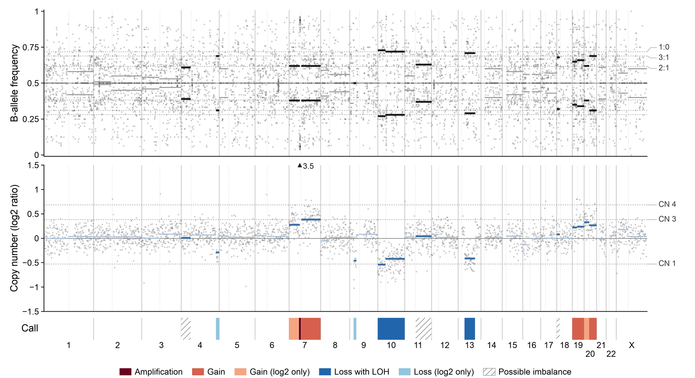

# 🧬 panel-baf

Genome-wide **B-allele frequency (BAF) and copy-number figure** from **hybrid-capture panel
sequencing** (Illumina paired-end, tumour only) – built from the **off-target reads**. Even with a
small panel (~150 kb) and only ~0.1× off-target depth, the figure shows LOH, gains, losses,
amplifications and the estimated tumour cell content. It builds on the off-target CNV profiling
approach of [Schnorrenberg et al. 2026](https://doi.org/10.1111/nan.70070) and adds allelic
imbalance (BAF/LOH). The target regions of the **NPMS v4** panel used there are included; other
hg19 panels work via `PANEL_BED`.

```text
📥 FASTQ ──▶ ✂️ fastp (optional) ──▶ 🧬 bwa-mem2 (hg19) ──▶ 🧹 markdup
                                                │
                 ┌──────────────────────────────┴──────────────────────────────┐
                 ▼                                                              ▼
   🔬 allele counts at 7.1 M 1000G SNPs                        📈 off-target read depth
      (on- and off-target)                                        (10 kb, GC + Alu corrected)
                 └──────────────▶ 🧮 BAF likelihood + joint HMM ◀───────────────┘
                                                │
                       📊 output/<sample>/<sample>.genome_BAF_logR.png / .pdf
```

## ✨ Overview

- 📊 **One deliverable:** a publication-ready figure at final print size (174 × 95 mm; 180 mm for
  Nature) with three aligned tracks – BAF, copy number (log2 ratio) and calls – as 600 dpi PNG and
  vector PDF with editable text.
- 🔬 **BAF without genotyping:** at ~0.1× single SNP genotypes cannot be called. Every SNP with
  ≥ 2 reads contributes a likelihood over the minor-allele fraction *b* of heterozygous SNPs
  (Hardy–Weinberg prior); summed over bins and segments this yields the MLE and 95 % CI of *b*.
- 🌍 **Ancestry calibration:** the 1000 Genomes superpopulation (EUR, AFR, AMR, EAS, SAS or global)
  is chosen by likelihood and the heterozygosity rate is fitted – global AFs otherwise create
  spurious genome-wide imbalance.
- 📈 **Off-target log2 ratio:** capture hotspots are discarded; correction for GC and **Alu density**
  (off-target capture is strongly Alu-driven).
- 🧮 **Segmentation and calls:** joint HMM over (log2 ratio, *b*) per chromosome arm, then an
  ASCAT-like fit of tumour cell content and allelic states (e.g. 2+1, 1+0). Calls: amplification,
  gain, loss with LOH, CN-LOH, possible imbalance.
- 🖥️ **SLURM / PALMA-II:** one job per sample, software from PALMA modules only (no conda),
  resumable steps (safe on `requeue`).

## 🚀 Quick start (PALMA)

```bash
git clone https://github.com/ctho1/panel-baf.git
cd panel-baf

# 1. Once: check the modules (report the output if anything is missing)
bash scripts/check_palma_modules.sh 2>&1 | tee palma_modules.txt

# 2. Copy the FASTQs into input/ and start (default panel: NPMS v4, see below)
cp /path/to/*_R1_001.fastq.gz /path/to/*_R2_001.fastq.gz input/
bash run_pipeline.sh --mail christian.thomas@ukmuenster.de
```

On the first run `prepare_reference.sh` runs as a preceding job (~30 min, mostly downloads:
1000G SNP panel, Alu track, cytobands, GC/mappability wigs; ~1 GB). hg19 and the bwa-mem2 index
are **not** rebuilt but linked from the shared reference
(`/cloud/wwu1/e_np_ngs/references/genomes/hg19.fa`). All sample jobs wait for the reference job
via `--dependency`.

Options:

```bash
bash run_pipeline.sh --partition normal            # fixed partition
FIG_WIDTH_MM=180 bash run_pipeline.sh              # Nature width
PANEL_BED=/path/to/other_panel_hg19.bed bash run_pipeline.sh   # another panel
```

## 🎯 Panel

`panel/NPMS_v4_targets_hg19.bed` contains the technical target regions of the **NPMS v4** panel
(400 regions, 150,948 bp, hg19; column 4 = capture tier), the small custom hybrid-capture panel
(< 0.2 Mb) published in [Schnorrenberg et al. 2026](https://doi.org/10.1111/nan.70070). It is the
default `PANEL_BED`. Any other hg19 target BED with UCSC
chromosome names (`chr1` …) can be used instead; targets ± 1 kb are masked for the off-target read
depth, on-target SNPs are used for the BAF.

## 📥 Input / 📤 Output

| Path | Content |
| --- | --- |
| `input/<sample>_R1_001.fastq.gz` + `_R2_001` | Illumina paired-end FASTQs (flat, no subfolders) |
| `panel/NPMS_v4_targets_hg19.bed` | panel targets (hg19), default `PANEL_BED` |
| **`output/<sample>/<sample>.genome_BAF_logR.png`** | figure, 600 dpi |
| **`output/<sample>/<sample>.genome_BAF_logR.pdf`** | figure, vector (editable text, rasterized points) |
| `tmp/<sample>/` | BAM, allele counts, 1-Mb bins, segments with calls, purity fit (intermediate) |

Trimmed FASTQs (only created if fastp is available) are deleted at the end of each sample job.

**Example output** – tumour sample, NPMS v4 panel, ~20 M read pairs (tumour cell content ~61 %):
gain of chromosome 7 with focal high-level amplification (off-scale, log2 3.5), loss with LOH of
chromosome 10 and 13q, gains of chromosomes 19 and 20.



## 🖼️ Figure

- **Top – B-allele frequency:** grey points are heterozygous-appearing SNPs (≥ 8 reads) and
  sliding 5-Mb BAF estimates (mirrored around 0.5); horizontal segments show *b* and 1 − *b*
  (dark = called, grey = not called).
- **Middle – copy number (log2 ratio)** of off-target read depth in 1-Mb bins; segments in muted
  blue; off-scale values are marked by a triangle with the actual value.
- **Bottom – calls:** red = gains, blue = losses, purple = CN-LOH, hatched = possible imbalance
  (palette checked for deuteranopia/protanopia).
- Faint dashed lines: expected levels for 1, 3 and 4 copies at the estimated tumour cell content
  (right margin: `CN n` and allele ratios `1:0`, `2:1`, `3:1`).

Layout, colours and line widths are defined in `scripts/figure_genome.py` (`STYLE`) and
`scripts/styles/publication.mplstyle`, so every sample renders identically.

## ⚙️ Software on PALMA

All programs come from the module system (`scripts/config.sh`); `scripts/check_palma_modules.sh`
lists the available versions and tests exactly these lists:

| Variable | Default | Purpose |
| --- | --- | --- |
| `BWA_MODULES` | `palma/2024a GCC/13.3.0 bwa-mem2/2.2.1` | alignment (`bwa-mem2 mem`) |
| `SAMTOOLS_MODULES` | `palma/2024a GCC/13.3.0 SAMtools/1.21` | sorting, duplicates, BAM access |
| `BCFTOOLS_MODULES` | `palma/2024a GCC/13.3.0 BCFtools/1.21 HTSlib/1.21` | allele counts, bgzip/tabix |
| `PYTHON_MODULES` | `palma/2024a GCC/13.3.0 SciPy-bundle/2024.05 matplotlib/3.9.2` | analysis + figure (numpy, scipy, pandas, matplotlib) |
| `FASTP_MODULES` | empty | optional trimming (the aligner soft-clips adapters anyway) |

Different versions can be set without editing files, e.g.
`BCFTOOLS_MODULES="palma/2023b GCC/13.2.0 BCFtools/1.19" bash run_pipeline.sh`.
Resources per sample: 16 CPUs, 48 GB, ≤ 2 h (typically ~15 min for 20 M read pairs).

**Local use (no module system):** `bash scripts/setup_envs.sh` creates a small conda env. Building
a bwa-mem2 index for hg19 needs ~90 GB RAM, so run locally with classic bwa:
`ALIGNER=bwa EXISTING_HG19_FASTA=/path/hg19.fa bash run_pipeline.sh`.

## 🧪 Tests

```bash
module purge && ml palma/2024a GCC/13.3.0 SciPy-bundle/2024.05
python3 -m unittest discover -s tests -v
```

Covered: the BAF likelihood on simulated low-depth SNPs (balanced, loss at 60 % purity, LOH),
hotspot-robust rate estimation, HMM segmentation, LOWESS, sample discovery and the figure helpers
(expected levels, label placement).

## ⚠️ Limitations

- No panel of normals: log2 amplitudes are compressed and gains of Alu-rich chromosomes (chr19)
  are partly corrected away – there the BAF is the more reliable evidence.
- Off-target BAF resolves LOH/imbalance from roughly 10 Mb upwards; subclonal or small events are
  not reliably detected. p-values ignore linkage disequilibrium → strict thresholds.
- Single sliding windows with *b* ≈ 0 in otherwise neutral regions can be germline runs of
  homozygosity, not tumour LOH.

> [!IMPORTANT]
> `input/`, `output/`, `tmp/`, `log/` and `references/` never belong in the repository. Review
> all results before any diagnostic use.

## 📖 Reference

If you use this pipeline, the NPMS v4 panel or its target regions, please cite:

> Schnorrenberg J, Adrian YL, Schlathölter J, Ruckert C, Horvath J, Paulus W, Hasselblatt M,
> Thomas C. Detection of Copy-Number Variations in CNS Tumours From Off-Target Reads of
> Hybrid-Capture Sequencing. *Neuropathol Appl Neurobiol.* 2026;52(2):e70070.
> doi:[10.1111/nan.70070](https://doi.org/10.1111/nan.70070) · PMID
> [41834733](https://pubmed.ncbi.nlm.nih.gov/41834733/) · PMCID
> [PMC12989910](https://pmc.ncbi.nlm.nih.gov/articles/PMC12989910/)
